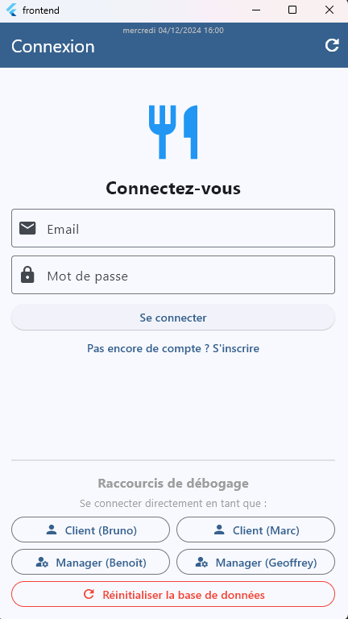
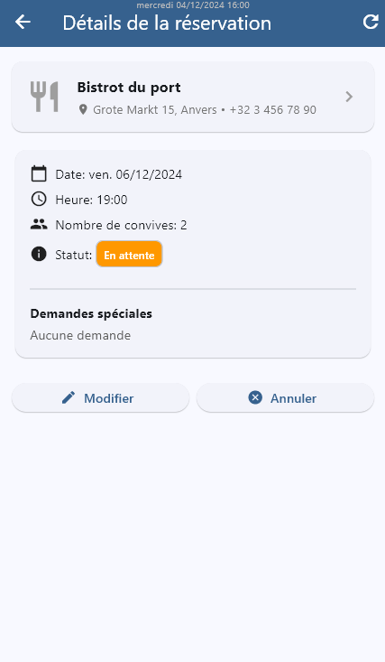
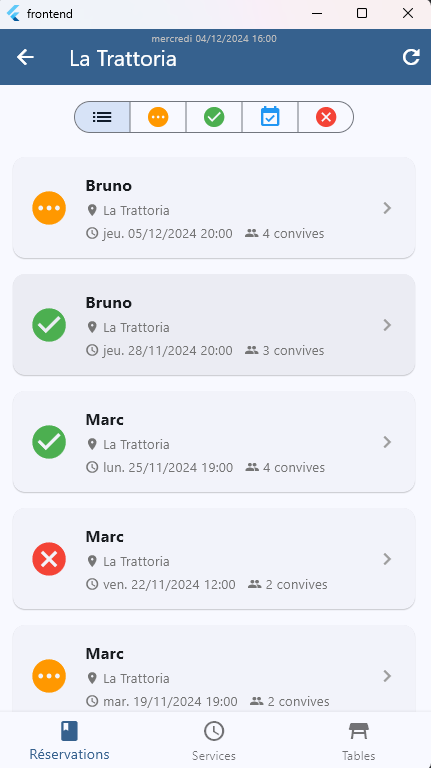

# ReserVite – Secure Restaurant Management & Reservation System

**ReserVite** is a comprehensive full-stack enterprise software solution dedicated to the centralized management and reservation of restaurant tables.

---

## What is the application for?

The application is structured around two authenticated user profiles:
* **Clients:** Can search for restaurants by criteria (city, price range), view available time slots, and schedule, modify, or cancel their reservations.
* **Managers:** Supervise their assigned establishments, validate pending requests, and physically assign tables to them.

At the core of this project is a **"Database-First"** and **"Security by Design"** architecture: 100% of complex calculation rules (schedule overlaps, maximum table capacities, temporal integrity) and data isolation are controlled and executed directly at the database server level.

---

## Key Features & Managed Business Rules

### 1. Advanced Database Engine (PostgreSQL)
* **Strict transactional integrity:** Implementation of check constraints, case-insensitive and trimmed uniqueness constraints, and foreign keys to prevent any data corruption.
* **Business rule triggers (BR-xx):** Development of automated triggers to handle multi-criteria checks:
  * **BR-02 & BR-06:** Automatic blocking if the guest count exceeds the cumulative capacity of assigned tables, and prohibition of double-booking a table within the same time slot.
  * **BR-04 & BR-05:** Dynamic and mandatory alignment of reservation times with the restaurant's specific time intervals (10, 15, 20, 30, or 60 min) and opening hours.
  * **BR-09 & BR-11:** Immutable lifecycle management of a reservation (`pending` → `confirmed` → `completed`/`cancelled`) with data locking once a final status is reached.

### 2. Watertight REST API (PostgREST)
* **RPC (Remote Procedure Call) Architecture:** Absolute security at the network layer. The web API only exposes PostgreSQL stored functions, completely hiding the underlying table structure.
* **3-Level Access Control:** Systematic HTTP request filtering (GET/POST) validating authentication (secure tokens), user role (Client vs. Manager), and resource ownership (a client can only read or modify their own reservations).

### 3. Reactive Graphical Interface (Flutter & Riverpod)
* **Centralized State Management:** Fine-tuned use of the Riverpod framework to ensure immediate local synchronization of lists and counters whenever a mutation action (creation, cancellation) is validated.
* **Business Ergonomics:** Dynamic search with a debouncing system to relieve server load, bottom-of-screen push notifications for business errors, and security confirmation dialogs.

---

## Technologies Used

* **Backend & Data:** PostgreSQL (Triggers, PL/pgSQL Functions, Composite Types)
* **API Layer:** PostgREST (Automatic mapping of database functions to REST endpoints)
* **Mobile/Desktop Frontend:** Dart, Flutter (Main target: Windows Desktop)
* **State Management:** Riverpod
* **Integration & Testing Tools:** IntelliJ REST Client (`.http` files), BitBucket (Git), Postman (design)

---

## Delivery Note

To facilitate testing and usage of the project, debugging features are accessible.

---

## Screenshots

